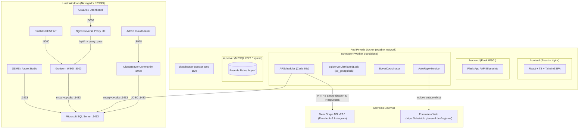

# GUÍA DE DESPLIEGUE Y OPERACIÓN EN DOCKER
## Agente Inteligente Multicanal para la Captación y Conversión de BUYERS — Parrilladas El Establo

---

## 1. ARQUITECTURA DE LA SOLUCIÓN DOCKERIZADA

El sistema está compuesto por una arquitectura distribuida de cinco contenedores interconectados mediante una red Docker puente privada (`establo_network`):



### Servicios del Clúster

| Servicio | Contenedor | Imagen Base | Puerto Expuesto | Descripción |
| :--- | :--- | :--- | :--- | :--- |
| **`frontend`** | `establo_frontend` | `node:20-alpine` → `nginx:1.27-alpine` | `3000:80` | Dashboard React compilado en producción y servido por Nginx con proxy inverso `/api/` hacia el backend. |
| **`backend`** | `establo_backend` | `python:3.11-slim` + msodbcsql18 | `5000:5000` | API REST protegida ejecutada con servidor WSGI Gunicorn (2 workers). Scheduler embebido desactivado. |
| **`scheduler`** | `establo_scheduler` | `python:3.11-slim` (misma imagen) | *Interno* | Worker independiente APScheduler que ejecuta ciclos cada 60s con bloqueo distribuido `sp_getapplock`. |
| **`sqlserver`** | `establo_sqlserver` | `mcr.microsoft.com/mssql/server:2022-latest` | `1433:1433` | Microsoft SQL Server 2022 Express con la base `buyer` y datos reales inicializados de forma persistente. |
| **`cloudbeaver`**| `establo_cloudbeaver`| `dbeaver/cloudbeaver:latest` | `8978:8978` | Administrador gráfico web de SQL Server para visualización y consultas SQL. |
| **`landing`**     | `landing`            | `node:24-alpine` → `nginx:1.27-alpine` | `4321:80` | Landing Page estática Astro 7 + Tailwind CSS 4 con menú de parrillas y formulario de captación. |

---

## 2. REQUISITOS PREVIOS

1. **Docker Desktop** instalado en Windows con motor WSL2 habilitado.
2. Memoria asignada a Docker: al menos 4 GB de RAM.
3. Puertos libres en Windows:
   - `3000` (Frontend Dashboard)
   - `4321` (Landing Page Parrilladas El Establo)
   - `5000` (Backend Flask API)
   - `8978` (CloudBeaver Web)
   - `1433` (SQL Server)

---

## 3. INICIO RÁPIDO

Para iniciar el sistema completo por primera vez:

```powershell
# 1. Posicionarse en la raiz del repositorio
cd C:\Users\jeanm\Downloads\agente-buyer

# 2. Iniciar todos los servicios construyendo las imagenes
docker compose up -d --build
```

El orden de inicio está coordinado con `healthchecks`:
1. `sqlserver` se inicia, espera al motor y ejecuta la inicialización segura de la base de datos `buyer`.
2. Una vez que `sqlserver` pasa su healthcheck (`SELECT 1 FROM buyer.dbo.plataforma;`), se inician `backend` y `cloudbeaver`.
3. Una vez que `backend` responde exitosamente en `/api/health`, se inician `scheduler` y `frontend`.

---

## 4. ACCESO A LAS APLICACIONES

| Aplicación | URL | Credenciales / Acceso |
| :--- | :--- | :--- |
| **Dashboard Web (React)** | [http://localhost:3000](http://localhost:3000) | Clave de administración: configurada en `ADMIN_API_KEY` |
| **Backend API (Flask)** | [http://localhost:5000](http://localhost:5000) | Healthcheck: `/api/health`, Diagnóstico: `/api/db/status` |
| **CloudBeaver (Web BD)** | [http://localhost:8978](http://localhost:8978) | Conexión preconfigurada `SQL Server (buyer)` |
| **SQL Server (Directo / SSMS)** | `localhost,1433` | Usuario: `sa` o `buyer_app`, Password en `.env` |

---

## 5. COMANDOS DE ADMINISTRACIÓN Y MONITOREO

### Ver el estado de todos los contenedores:
```powershell
docker compose ps
```

### Consultar los logs en tiempo real:
```powershell
# Monitorear sincronizacion de Meta y respuestas automaticas
docker compose logs -f scheduler

# Monitorear solicitudes al backend
docker compose logs -f backend

# Monitorear logs del motor SQL Server e inicializacion
docker compose logs -f sqlserver

# Monitorear logs de Nginx y acceso al frontend
docker compose logs -f frontend

# Monitorear logs de CloudBeaver
docker compose logs -f cloudbeaver
```

### Detener los servicios:
```powershell
# Detener sin eliminar volumenes (datos persistidos)
docker compose down

# Reiniciar los servicios
docker compose up -d
```

### Reconstruir un servicio específico tras cambios en código:
```powershell
docker compose build backend
docker compose up -d backend
```

---

## 6. GESTIÓN DE BASE DE DATOS Y CONEXIÓN SSMS

### Conexión desde SQL Server Management Studio (SSMS):
- **Server name**: `localhost,1433` o `127.0.0.1,1433`
- **Authentication**: SQL Server Authentication
- **Login**: `sa` (o `buyer_app`)
- **Password**: El valor configurado en `MSSQL_SA_PASSWORD` (`EstabloBuyer2026!DbPass`)
- **Trust Server Certificate**: Marcado (True)
- **Encrypt**: Optional / Mandatory según la versión de SSMS

### Respaldar la base de datos `buyer` desde Docker:
```powershell
docker exec -it establo_sqlserver /opt/mssql-tools18/bin/sqlcmd -S localhost -U sa -P "EstabloBuyer2026!DbPass" -C -Q "BACKUP DATABASE buyer TO DISK = '/var/opt/mssql/data/buyer_backup.bak' WITH INIT, STATS = 10;"

# Copiar el respaldo al host de Windows
docker cp establo_sqlserver:/var/opt/mssql/data/buyer_backup.bak ./database/buyer_backup.bak
```

### Restaurar un respaldo `.bak` en Docker:
```powershell
docker cp ./database/buyer_backup.bak establo_sqlserver:/var/opt/mssql/data/buyer_backup.bak

docker exec -it establo_sqlserver /opt/mssql-tools18/bin/sqlcmd -S localhost -U sa -P "EstabloBuyer2026!DbPass" -C -Q "ALTER DATABASE buyer SET SINGLE_USER WITH ROLLBACK IMMEDIATE; RESTORE DATABASE buyer FROM DISK = '/var/opt/mssql/data/buyer_backup.bak' WITH REPLACE; ALTER DATABASE buyer SET MULTI_USER;"
```

---

## 7. DETALLES DE AUTOMATIZACIÓN (SCHEDULER & AUTO-REPLY)

1. **Ciclo de 60 Segundos**:
   - El contenedor `scheduler` ejecuta `run_scheduler.py` con `META_SYNC_INTERVAL_MINUTES=1`.
   - Consulta publicaciones y comentarios de Facebook e Instagram.
   - Detecta si un usuario es un BUYER potencial.
   - Si un comentario califica para respuesta automática y `AUTO_REPLY_ENABLED=true`:
     - Genera respuesta contextualizada según intención (consulta de precios, reserva, promociones, carta, etc.).
     - Incluye el formulario oficial `https://elestablo.giansmd.dev/registro/`.
     - Si `AUTO_REPLY_DRY_RUN=false`, envía la respuesta real mediante Meta Graph API y almacena el ID retornado en `dbo.respuesta_automatica`.
2. **Bloqueo Distribuido**:
   - `SCHEDULER_LOCK_TYPE=sql_server` utiliza `sp_getapplock` con recurso `AgenteBuyer_SyncScheduler_Lock`.
   - Garantiza que solo un worker ejecute la sincronización, impidiendo duplicidad de respuestas o auditorías.
3. **Persistencia Total**:
   - Los datos de SQL Server se almacenan en el volumen nombrado `establo_sqlserver_data`.
   - Al ejecutar `docker compose down` y posteriormente `docker compose up -d`, todas las publicaciones, comentarios, buyers y respuestas se conservan íntegramente.
