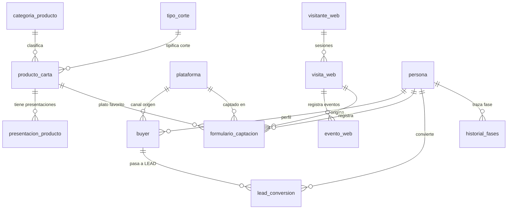

# Diccionario de Datos y Modelo Relacional Flexible — Base de Datos `buyer`

**Sistema:** Agente Inteligente Multicanal BUYER — Parrilladas El Establo  
**Documento:** Especificación Arquitectónica del Catálogo de la Carta y Flujo de Captación BUYER → LEAD  
**Versión:** 2.0 (Prompt 17)  
**Fecha:** Noviembre 2026

---

## 1. Resumen Ejecutivo de la Evolución del Esquema

El esquema relacional original de `dbo.producto_carta` fue diseñado con suposiciones iniciales rígidas:
- `categoria VARCHAR(15)` con restricción `CK_producto_categoria IN ('COMIDA','BEBIDA','POSTRE')`.
- `nombre NVARCHAR(120) NOT NULL UNIQUE`.
- `peso_unidad VARCHAR(5)` con restricción `CK_producto_peso_unidad IN ('g','ml','L')`.

Al analizar la carta gastronómica real del restaurante (*Parrilladas El Establo*), se identificaron 146 productos/presentaciones agrupados en 9 categorías reales (`res`, `cerdo`, `pollo`, `entradas`, `combos`, `ensaladas`, `acompanamientos`, `bebidas`, `vinos`) con 18 agrupaciones comerciales (`Angus · Americana y uruguaya`, `Costillas`, `Limonadas`, `Vinos de Argentina/Chile/Perú/España`, etc.). 

Además, existen productos con el mismo nombre y corte pero diferentes gramajes y precios (ejemplo: *Lomo fino 400 g S/ 64* vs *Lomo fino 300 g S/ 54*; *Chuleta de cerdo 500 g S/ 51* vs *Chuleta de cerdo 300 g S/ 39*; vinos con botellas de 750 ml y 375 ml).

Para resolver esto sin perder integridad referencial histórica con Facebook e Instagram (cuyas campañas y mensajes apuntan a los IDs de producto 1 a 8):
1. Se crearon tablas catálogo normalizadas: `dbo.categoria_producto`, `dbo.tipo_corte`, `dbo.termino_coccion`.
2. Se amplió y flexibilizó `dbo.producto_carta` (adición de `id_categoria`, `grupo_comercial`, `id_tipo_corte`, `pais_origen`, `es_apto_favorito`, `destacado`, `imagen`, `orden`).
3. Se creó la tabla `dbo.presentacion_producto` para modelar de forma precisa cada gramaje, volumen, precio y porción.
4. Se actualizó la restricción de `dbo.evento_web` para permitir eventos específicos de la landing (`CLIC_CARTA`, `VISTA_CARTA`).

---

## 2. Diagrama de Relaciones del Catálogo y Flujo BUYER → LEAD

---

## 3. Especificación Detallada de Tablas y Columnas

### 3.1. `dbo.categoria_producto`
Catálogo de las 9 categorías reales de la carta del restaurante.

| Columna | Tipo | Nulo | Descripción |
| :--- | :--- | :--- | :--- |
| `id_categoria` | `VARCHAR(20)` | NO | **PK**. Código canónico (`res`, `cerdo`, `pollo`, `entradas`, `combos`, `ensaladas`, `acompanamientos`, `bebidas`, `vinos`). |
| `titulo` | `NVARCHAR(100)` | NO | Nombre visible (`Carnes de res`, `Combos para compartir`, etc.). |
| `descripcion_nota` | `NVARCHAR(500)` | SÍ | Aclaración oficial (guarniciones incluidas, ordenanzas, costo frozen, etc.). |
| `orden` | `INT` | NO | Secuencia de presentación en la carta (1 a 9). |
| `activa` | `BIT` | NO | Estado de disponibilidad (1 = activa). |

### 3.2. `dbo.tipo_corte`
Catálogo de cortes vacunos y porcinos documentados explícitamente en la carta.

| Columna | Tipo | Nulo | Descripción |
| :--- | :--- | :--- | :--- |
| `id_tipo_corte` | `INT IDENTITY(1,1)` | NO | **PK**. Identificador autoincremental del corte. |
| `codigo` | `VARCHAR(30)` | NO | **UQ**. Clave (`PICANHA`, `LOMO_FINO`, `ENTRANA_FINA`, `BIFE_ANCHO`, etc.). |
| `nombre` | `NVARCHAR(100)` | NO | Nombre gastronómico legible (`Picaña / Picanha`, `Lomo Fino`, etc.). |
| `descripcion` | `NVARCHAR(250)` | SÍ | Características anatómicas / organolépticas del corte. |
| `activo` | `BIT` | NO | Estado (1 = activo). |

### 3.3. `dbo.termino_coccion`
Catálogo para la propuesta funcional de términos de cocción. **No se asigna como atributo fijo al producto**, sino que queda disponible para reservas o pedidos donde el cliente elija su preferencia.

| Columna | Tipo | Nulo | Descripción |
| :--- | :--- | :--- | :--- |
| `id_termino` | `INT IDENTITY(1,1)` | NO | **PK**. Identificador autoincremental. |
| `codigo` | `VARCHAR(30)` | NO | **UQ**. (`AZUL`, `INGLESA`, `MEDIO`, `TRES_CUARTOS`, `BIEN_COCIDO`). |
| `nombre` | `NVARCHAR(50)` | NO | Nombre descriptivo (`Término medio`, `A la inglesa`, etc.). |
| `descripcion` | `NVARCHAR(250)` | SÍ | Punto térmico y temperatura aproximada en centro. |
| `orden` | `INT` | NO | Secuencia de menos a más cocido (1 a 5). |
| `activo` | `BIT` | NO | Estado (1 = activo). |

### 3.4. `dbo.producto_carta` (Evolucionada)
Representa los productos lógicos del restaurante.

| Columna | Tipo | Nulo | Modificación / Rol |
| :--- | :--- | :--- | :--- |
| `id_producto` | `INT IDENTITY(1,1)` | NO | **PK**. Mantiene registros históricos 1..8 y alberga los 120 productos reales. |
| `nombre` | `NVARCHAR(120)` | NO | Nombre comercial (`Lomo fino`, `Mixta Grande`, `Coca Cola Zero`). Se removió UQ global. |
| `categoria` | `VARCHAR(30)` | NO | Nombre de categoría visible (mantiene compatibilidad previa). |
| `id_categoria` | `VARCHAR(20)` | SÍ | **FK** -> `categoria_producto(id_categoria)`. Vinculación normalizada. |
| `grupo_comercial`| `NVARCHAR(100)` | SÍ | **NUEVA**. Agrupación comercial en carta (`Angus · Americana y uruguaya`, `Gaseosas`, `Perú`, etc.). |
| `id_tipo_corte` | `INT` | SÍ | **NUEVA FK** -> `tipo_corte(id_tipo_corte)`. Solo aplica a carnes (NULL en otros). |
| `pais_origen` | `NVARCHAR(50)` | SÍ | **NUEVA**. Origen explícito comprobado (`Perú`, `Argentina`, `Chile`, `España`). |
| `descripcion` | `NVARCHAR(500)` | SÍ | Descripción, composición de combo o ingredientes. |
| `estilo` | `NVARCHAR(50)` | SÍ | Campo histórico preservado. |
| `peso_cantidad` | `DECIMAL(9,2)` | SÍ | Cantidad de referencia de presentación principal. |
| `peso_unidad` | `VARCHAR(20)` | SÍ | Unidad (`g`, `kg`, `ml`, `L`, `unidades`, `palitos`, `personas`). |
| `precio` | `DECIMAL(10,2)` | NO | Precio base en soles con IGV (monto mínimo entre sus presentaciones). |
| `es_apto_favorito`| `BIT` | NO | **NUEVA**. 1 = elegible para dropdown "Tu plato favorito" (platos, cortes, combos; 0 = bebidas/salsas). |
| `destacado` | `BIT` | NO | **NUEVA**. 1 = plato destacado para el Hero/Home de la landing. |
| `imagen` | `VARCHAR(255)` | SÍ | **NUEVA**. Ruta de la fotografía (`/img/picanha.jpg`, etc.). |
| `orden` | `INT` | NO | **NUEVA**. Orden de despliegue en la carta. |
| `activo` | `BIT` | NO | Estado de vigencia (1 = activo). |

### 3.5. `dbo.presentacion_producto`
Alberga las 146 presentaciones exactas con gramajes, botellas y precios reales.

| Columna | Tipo | Nulo | Descripción |
| :--- | :--- | :--- | :--- |
| `id_presentacion` | `INT IDENTITY(1,1)` | NO | **PK**. Clave autoincremental de presentación. |
| `id_producto` | `INT` | NO | **FK** -> `producto_carta(id_producto)`. Producto lógico padre. |
| `nombre_presentacion`| `NVARCHAR(150)`| NO | Detalle textual original (`400 g`, `300 g`, `750 ml`, `Ideal para 7 personas`). |
| `precio` | `DECIMAL(10,2)` | NO | Precio exacto en soles con IGV. |
| `peso_volumen_cantidad`| `DECIMAL(9,2)`| SÍ | Valor numérico extraído (`400.00`, `1.00`, `750.00`, etc.). |
| `unidad_medida` | `VARCHAR(20)` | SÍ | Unidad técnica (`g`, `kg`, `ml`, `L`, `unidades`, `palitos`, `personas`). |
| `variedad_vino` | `NVARCHAR(100)` | SÍ | Cepa o variedad vinícola (`Malbec`, `Cabernet Sauvignon`, `Carmenere`, etc.). |
| `descripcion_presentacion`| `NVARCHAR(500)`| SÍ | Detalle específico de esta variante si difiere del padre. |
| `destacado` | `BIT` | NO | 1 si la presentación específica es destacada. |
| `imagen` | `VARCHAR(255)` | SÍ | Imagen específica. |
| `orden` | `INT` | NO | Orden relativo dentro del producto. |
| `activo` | `BIT` | NO | Estado (1 = activo). |

---

## 4. Diferencias entre Esquema Anterior y Esquema Nuevo

| Aspecto | Esquema Anterior (v1.0) | Esquema Nuevo (v2.0) |
| :--- | :--- | :--- |
| **Categorías** | Restringidas por CHECK a `'COMIDA'`, `'BEBIDA'`, `'POSTRE'`. | Normalizadas en tabla `categoria_producto` con las 9 categorías reales y sus notas legales. |
| **Unicidad de Nombre** | `nombre UNIQUE` impedía tener múltiples gramajes del mismo corte (ej. Lomo fino 300g y 400g). | Se separó el producto lógico de su `presentacion_producto`. |
| **Presentaciones y Gramajes** | Limitado a `peso_unidad IN ('g','ml','L')`. | Soporta `kg`, `oz`, `unidades`, `palitos`, `personas`, `Jarra`, y varietales de vino. |
| **Cortes y Términos** | Sin catálogo de cortes ni propuesta de cocción. | Catálogos `tipo_corte` y `termino_coccion` completamente estructurados. |
| **Selector de Plato Favorito** | Hardcodeado en el cliente TypeScript. | Consulta dinámica mediante `es_apto_favorito = 1`, filtrando bebidas y salsas en SQL Server. |
| **Eventos de Landing** | Solo permitía `'VER_MENU'`. | Ampliado a `'CLIC_CARTA'`, `'VISTA_CARTA'`, `'ENVIO_FORMULARIO'`. |
| **Cantidad de Registros** | 8 productos demo iniciales. | 120 productos lógicos, 146 presentaciones reales, reconciliadas al centavo (S/ 7,231.00). |

---

## 5. Instrucciones de Ejecución de Scripts

### En una base de datos ya creada (Entorno actual):
Ejecutar en orden:
1. `database/04_MIGRACION_CARTA_FLEXIBLE.sql`: Crea las nuevas tablas y aplica cambios aditivos no destructivos.
2. `database/05_CARGAR_CATALOGO_REAL.sql`: Carga y reconcilia idempotentemente los 120 productos y 146 presentaciones.
3. `database/06_LIMPIEZA_PRUEBAS_CONFIRMADAS.sql`: Limpieza segura de datos sintéticos de pruebas automatizadas.
4. `database/07_MIGRACION_GASTO_ANUNCIO.sql`: Migración aditiva para soporte de gastos académicos simulados y vista compatible.
5. `database/seed_gastos_academicos.sql`: Carga de gasto publicitario simulado etiquetado como `SIMULADO_ACADEMICO`.

### En una instalación desde cero (Entorno nuevo):
Ejecutar en orden:
1. `database/01_CREAR_BUYER_FINAL.sql`: Crea todo el esquema de 26 tablas incluyendo la estructura flexible.
2. `database/02_LLENAR_BUYER_FINAL.sql`: Puebla las plataformas, segmentos y campañas iniciales.
3. `database/03_CREAR_RESPUESTA_AUTOMATICA.sql`: Puebla las reglas de respuesta automática.
4. `database/05_CARGAR_CATALOGO_REAL.sql`: Carga los 120 productos y 146 presentaciones reales.
5. `database/07_MIGRACION_GASTO_ANUNCIO.sql`: Aplica la estructura aditiva de gastos publicitarios.
6. `database/seed_gastos_academicos.sql`: Carga los presupuestos académicos de prueba.

---

## 6. Evolución del Módulo de Marketing y Gastos Publicitarios (Prompt 19)

### 6.1. `dbo.gasto_anuncio_diario` (Evolución Aditiva)
Permite registrar tanto gastos reales de anuncios de Meta Ads como inversiones simuladas para cálculo de KPIs académicos:

| Columna | Tipo | Nulo | Descripción |
| :--- | :--- | :--- | :--- |
| `id_gasto` | `INT IDENTITY(1,1)` | NO | **PK**. Identificador del registro diario de gasto. |
| `id_anuncio` | `INT` | SÍ | **FK** -> `dbo.anuncio(id_anuncio)`. Nullable para permitir imputación directa a campaña. |
| `id_campana` | `INT` | SÍ | **FK** -> `dbo.campana(id_campana)`. Vinculación directa con la campaña. |
| `id_plataforma` | `INT` | SÍ | **FK** -> `dbo.plataforma(id_plataforma)`. Canal publicitario (1=Facebook, 2=Instagram). |
| `fecha_gasto` | `DATE` | NO | Fecha del devengo del gasto publicitario. |
| `gasto` | `DECIMAL(10,2)` | NO | Monto invertido en moneda local. |
| `moneda` | `VARCHAR(3)` | NO | Código ISO de moneda (`PEN`). |
| `origen_dato` | `VARCHAR(30)` | NO | Procedencia (`META_ADS_API`, `SIMULADO_ACADEMICO`, `MANUAL`). |
| `es_simulado` | `BIT` | NO | 1 = Inversión académica para cálculo de CPA sin alterar métricas operativas. |
| `observacion` | `NVARCHAR(255)` | SÍ | Glosa descriptiva del gasto. |
| `fecha_creacion`| `DATETIME` | NO | Marca de tiempo de registro. |

### 6.2. Vista de Compatibilidad `dbo.gasto_anuncio`
Facilita la consulta unificada de gastos y presupuestos diarios tanto a nivel de anuncio individual como de campaña o plataforma.
